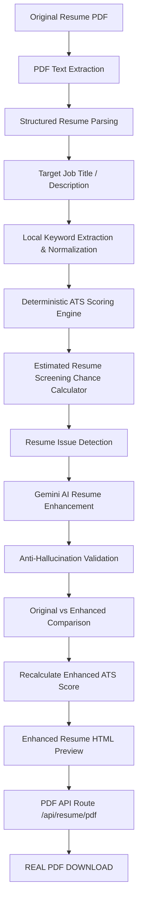

# ResumeIQ AI - AI-Powered Resume ATS Analyzer and Resume Enhancement System

ResumeIQ AI is a production-quality, standalone web application that enables candidates to analyze their resumes against a target job description, receive a deterministic ATS compatibility score, detect critical formatting or content issues, and intelligently enhance their resumes using Google Gemini AI while ensuring strict factual accuracy.

---

## Core Features

- **PDF Only Input**: Accepts only standard text-based PDF resumes (up to 10MB) and extracts text server-side.
- **Deterministic ATS Scoring**: Scores the resume from 0 to 100 based on an 8-category weighting model. Gemini **does not** decide or generate the score.
- **Estimated Screening Chance**: Calculations run locally on the application server to estimate likelihood of recruiter screening.
- **Keyword and Issue Detection**: Analyzes matched, missing, and weak keywords alongside structural resume flaws.
- **Factual Integrity Validation**: Features an anti-hallucination check that compares Gemini's optimized resume back to the original PDF resume, filtering out any invented metrics, company names, or credentials.
- **Side-by-Side Comparison**: Desktop split-screen layout displaying original vs. optimized resume content with interactive explanations of modifications.
- **Searchable PDF Downloads**: Generates and downloads real, selectable A4 PDF documents for the optimized resume and the ATS analysis report.

---

## System Architecture

The application uses a **Hybrid AI Architecture**, combining deterministic local algorithms for text parsing and scoring with Gemini AI for natural language enhancement:



---

## ATS Scoring Formula

The ATS scoring engine computes a deterministic score out of 100 based on the following breakdown:

$$\text{ATS Score} = \text{Keyword Match (30)} + \text{Tech Skills (20)} + \text{Exp Relevance (15)} + \text{Proj Relevance (10)} + \text{Structure (10)} + \text{Action Verbs (5)} + \text{Quantified Achievements (5)} + \text{Formatting (5)}$$

### Estimated Screening Chance Formula

Calculated locally on the server using:

$$\text{Screening Chance} = 40\% \text{ (ATS Score)} + 20\% \text{ (Req. Skills)} + 15\% \text{ (Keywords)} + 10\% \text{ (Experience)} + 10\% \text{ (Projects)} + 5\% \text{ (Quality)}$$

---

## Integration Setup Instructions

If setting up this project from scratch, follow these instructions to integrate TypeScript, Tailwind CSS, and the shadcn CLI:

### 1. Initialize TypeScript
If the codebase is not configured with TypeScript, initialize it using:
```bash
npm install -D typescript @types/react @types/react-dom @types/node
npx tsc --init
```
Configure your `tsconfig.json` paths mapping:
```json
"paths": {
  "@/*": ["./src/*"]
}
```

### 2. Set Up Tailwind CSS
Install Tailwind, PostCSS, and Autoprefixer:
```bash
npm install -D tailwindcss postcss autoprefixer
npx tailwindcss init -p
```
Configure `tailwind.config.js` to scan files inside the `src` folder:
```javascript
content: [
  "./src/pages/**/*.{js,ts,jsx,tsx,mdx}",
  "./src/components/**/*.{js,ts,jsx,tsx,mdx}",
  "./src/app/**/*.{js,ts,jsx,tsx,mdx}",
]
```

### 3. Initialize shadcn/ui CLI
Run the official shadcn initialization command to configure paths and create standard themes:
```bash
npx shadcn-ui@latest init
```
This command creates a `components.json` configuration file, binds custom style variables to your CSS file (`src/app/globals.css`), and sets the default components directory path.

---

## Default Path for Components and Styles

- **Default Components Directory**: `src/components/ui/`
- **Default Style Configuration**: `src/app/globals.css`
- **Path Alias**: `@/components/ui/...`

### Why creating `components/ui/` is important:
1. **Separation of Concerns**: Isolates atomic UI primitives (e.g., `Button`, `Input`, `Dialog`) from route layouts and page business logic.
2. **Automated CLI Integration**: The shadcn CLI depends on this directory structure. Adding new components (e.g., `npx shadcn-ui@latest add button`) automatically targets this folder, inserting typescript files and configuring style variables without breaking imports.
3. **Consistency**: Establishes consistent path aliases across files, making imports predictable and cleaner.

---

## Installation & Running Locally

1. **Clone the repository and navigate to the directory**:
   ```bash
   cd resumeiq-ai
   ```

2. **Install dependencies**:
   ```bash
   npm install
   ```

3. **Configure Environment Variables**:
   Create a `.env.local` file in the root directory:
   ```bash
   GEMINI_API_KEY=your-actual-api-key-here
   GEMINI_MODEL=gemini-2.0-flash
   ```

4. **Run the Development Server**:
   ```bash
   npm run dev
   ```
   Open [http://localhost:3000](http://localhost:3000) in your browser.

5. **Build for Production**:
   ```bash
   npm run build
   ```

---

## Privacy & Limitations

- **No Data Retention**: Uploaded PDF files are read into a memory buffer, parsed, and immediately discarded. No databases or file logs are used.
- **Local Parsing**: Resume parser runs locally in Next.js Server routes. Original PDF binaries are **never** transmitted to the Gemini API.
- **Scanned PDFs**: Scanned image-only PDFs are not supported. Only text-based PDF documents are parsed.
